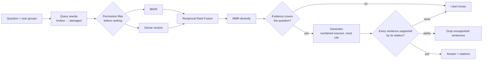

# rag-knowledge-agent

[](https://github.com/ndanetaadmire-debug/rag-knowledge-agent-/actions/workflows/ci.yml)


**A company-knowledge assistant that cites its sources, respects who is allowed to read what, and says "I don't know" instead of guessing.**

Most RAG demos embed some PDFs and hope. This one is built around the failure modes that make RAG unsafe in a real company: leaking restricted documents, answering from irrelevant context, and fluent sentences whose citation doesn't actually say that.

```
$ ragkit ask "My order arrived broken, what should I do?"
If an item arrives damaged, the customer must report it within 7 days and include photos. [2]
  [2] Refunds and Returns Policy > Damaged items

$ ragkit ask "How many annual leave days do staff get?"              # not in HR
I don't know based on the available documents.

$ ragkit ask "How many annual leave days do staff get?" --groups hr
Permanent staff accrue 1.25 days of annual leave per month, which is 15 working days per year. [1]
  [1] Staff Leave Policy > Annual leave
```

## Pipeline



| Stage | Why it's there |
|---|---|
| **Structure-aware chunking** | Splits on Markdown headings and keeps the heading path on every chunk ("Refunds > Damaged items"), packs whole paragraphs, overlaps one capped sentence |
| **Permission filter first** | Chunks carry allowed groups; filtering happens *before* scoring, so restricted text can't rank, be quoted or leak into a prompt |
| **Hybrid retrieval** | BM25 finds exact terms (codes, names, "R2,000"); dense vectors find paraphrases. **RRF** fuses ranks without calibrating incomparable scores |
| **MMR** | Five near-identical chunks waste the context window; MMR trades a little relevance for coverage |
| **Query rewriting** | Users say "broken" and "minimum length"; policies say "damaged" and "at least 14 characters". Pluggable: a curated map by default, an LLM rewrite in production |
| **Evidence gate** | Refuses when the best chunk doesn't cover the question, which is how RAG avoids answering from irrelevant context |
| **Grounding verifier** | Each sentence must cite a real source and share most of its content words with it; unsupported sentences are removed, and if none survive, it refuses |

The embedder and generator are **ports**. The defaults (a feature-hashing embedder and an extractive generator) are deterministic so tests and CI need no API keys; swap in OpenAI, Azure OpenAI or a local model without touching the pipeline. A test plugs in a deliberately hallucinating generator and asserts the verifier refuses its answer.

## Retrieval quality is measured in CI

`data/qa.json` is a labelled set: questions with the document and section that should answer them, permission-scoped questions, and questions that **must** be refused (off-topic, or restricted for that user).

```
$ ragkit eval data/qa.json
recall@4=100%  MRR=0.96  refusal-accuracy=100%  n=17
```

The `retrieval-eval` job fails the build if recall@4 or refusal accuracy drops below 90%. Two real fixes came from this gate while building: query rewriting (two questions were wrongly refused for vocabulary reasons) and a chunk-overlap bug that made chunks grow without bound on unpunctuated text.

## Run

```bash
pip install -e ".[dev]"
ragkit ask "Is shipping free for big orders?"
ragkit eval data/qa.json
uvicorn ragkit.api:create_app --factory      # POST /ask with header x-user-groups: hr
pytest --cov && mypy && ruff check src tests
```

Documents live in `data/handbook/*.md`; `acl.json` maps a document to the groups allowed to read it.

---

Built by **[Admire T. Ndaneta](https://admire-portfolio.vercel.app)**. MIT licensed.
